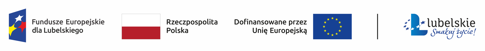

Projekt „Kształcenie zawodowe – nowe perspektywy” współfinansowany ze środków Europejskiego Funduszu Społecznego Plus w ramach programu Fundusze Europejskie dla Lubelskiego 2021–2027

# Obrazy do kursu „JavaScript Developer React”

To repozytorium przechowuje obrazy używane w prezentacjach kursu „JavaScript Developer React” (Technikum nr 2 w Kraśniku). Obrazy są materiałem kursu: ilustracje, diagramy i zrzuty ekranu pokazywane na slajdach. Prezentacje pobierają je z publicznych adresów w tym repozytorium.

Nie musisz tu nic robić. Ćwiczenia znajdziesz w osobnym repozytorium `js-react-krasnik`.

## Jak jest ułożone

Obrazy leżą w folderach o nazwach takich jak moduły kursu, na przykład `01-linux-terminal/` i `02-git-github/`. Folder pojawia się razem z obrazami do danego modułu.

## Logotypy

Plik `materialy/logotypy-fe.png` to pasek logotypów projektu: Fundusze Europejskie dla Lubelskiego, Rzeczpospolita Polska, Dofinansowane przez Unię Europejską i Lubelskie. Występuje na slajdach tytułowych i w README repozytoriów kursu.

## Licencje i źródła

Każdy obraz ma na slajdzie podpis z autorem, źródłem i licencją. Ilustracje wygenerowane przez AI są tak oznaczone.

## Kontakt

Masz pytanie? Napisz przez platformę Python Lab. Adres e-mail opiekuna znajdziesz na platformie.
